<div align="center">

# 🎓 IPEDS Outcomes Lab

**What actually predicts whether students finish — measured on the real federal record of U.S. higher education.**

[](#data--provenance)
[](#the-panel)
[](#predicting-completion)
[](LICENSE)

*Admissions, enrollment, retention, completion, aid and finance for 8,670 institutions — harmonized into one panel,
clustered into peer groups, modeled with gradient boosting + SHAP, and cut for equity: the Pell completion gap.*

</div>

---

## Why this exists

Institutional-research teams answer three questions every year: *How do we compare to our peers? What drives our
completion rate? And are we serving low-income students as well as everyone else?* This repo answers all three on
the authoritative public dataset — **IPEDS** (the Integrated Postsecondary Education Data System, run by the
National Center for Education Statistics) — with a fully scripted, reproducible pipeline: raw NCES bulk files in,
tidy panel, charts, peer groups, a predictive model and a Power BI-ready star schema out.

> **Every number below comes from the executed pipeline.** Metrics are saved to `outputs/metrics.json` by the
> analysis scripts themselves; the README quotes that file. If a number isn't in the run, it isn't in the README.

## The panel

| | |
|---|---|
| Source | NCES IPEDS Data Center bulk downloads (see [Provenance](#data--provenance)) |
| Coverage | Fall **2015–2023**, **8,670** institutions, **60,885** institution-years × 74 variables |
| Analysis population | **27,005** rows for four-year, degree-granting institutions (2,859 in 2023) |
| Surveys harmonized | Directory (HD), Admissions (ADM), Fall Enrollment (EF-A/D), Graduation Rates (GR), Student Financial Aid (SFA), Finance (F1A/F2/F3), 12-Month Enrollment (EFIA), Outcome Measures (OM) |

Graduation rates are **rebuilt from the raw GR cell structure** (adjusted cohort, completers at 100%/150%, by
race/ethnicity) rather than copied from a summary file — and validated against published figures (Harvard's
rebuilt 2022 rate: **97.8%**, matching IPEDS). Finance is unified across the three reporting forms (GASB publics,
FASB nonprofits, for-profits) into instructional spending per FTE student. The [data dictionary](data_dictionary.md)
documents every variable, the cross-survey alignment convention, and every definition change found along the way
(SAT redesign, the OM pilot year, Carnegie vintage changes, and more).

## Key findings

### 1 · Completion is drifting up — slowly, and unevenly

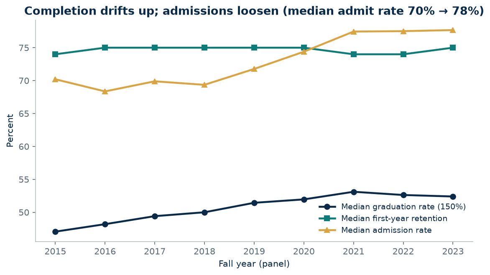

- The median four-year institution's graduation rate (150% of normal time) rose from **47.1%** (2015 panel) to
  **52.4%** (2023). The on-time (100%) median rose faster, **32.1% → 40.7%** — more students finishing in four
  years, not just eventually.
- Median first-year retention barely moved (**74–75%** all nine years) — the gains are in *finishing*, not in
  *keeping* students past year one.
- Admissions loosened over the same decade: the median admission rate rose from **70.2%** to **77.7%**, with most
  of the loosening after 2019 (the test-optional era).
- Sector medians (2022): private nonprofit **57.3%**, private for-profit **50.0%**, public **47.0%** — a ranking
  that says more about who enrolls than about who teaches best, which is what the rest of this repo is for.

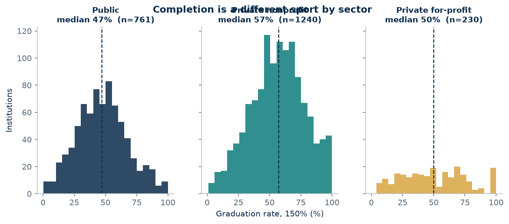

### 2 · What completion correlates with (2022 cross-section)

| Signal | Correlation with graduation rate |
|---|---|
| SAT total midpoint (enrolled students) | **+0.82** |
| First-year retention | +0.52 |
| Pell share of undergraduates | −0.37 |
| Instructional spending per FTE | +0.35 |
| Admission rate | −0.32 |
| Student–faculty ratio | −0.18 |

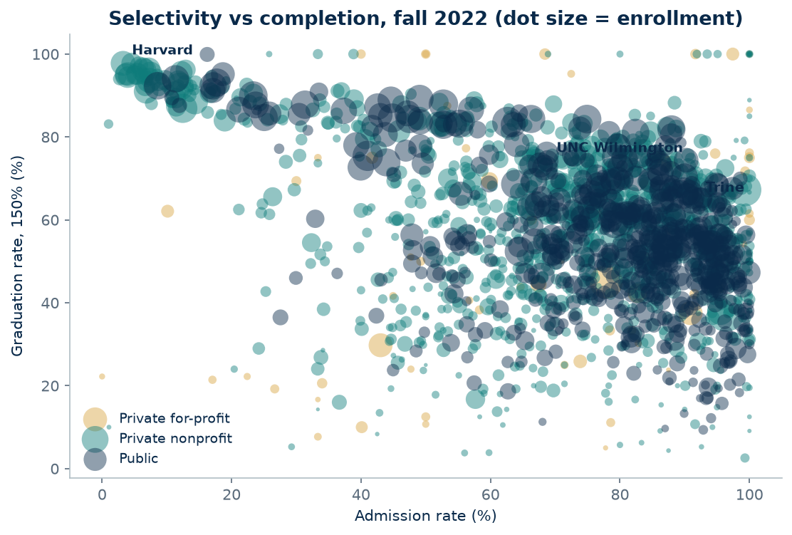

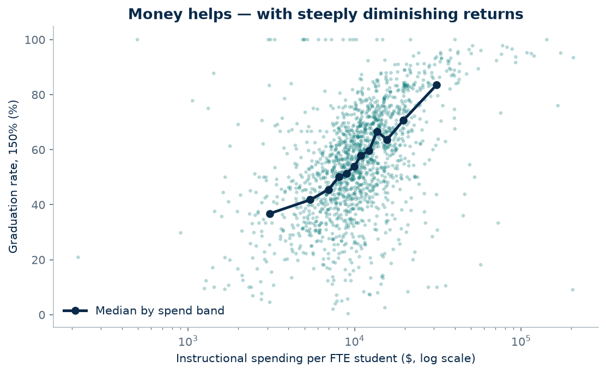

Money helps — with visibly diminishing returns (median instructional spend: **$10,480 per FTE**). And the
strongest single correlate is the SAT profile of the students an institution *admits* — a selection effect,
not a teaching effect. Correlation tables are where honest analysis starts, not where it ends:

### 3 · Completion gaps by race/ethnicity are not closing

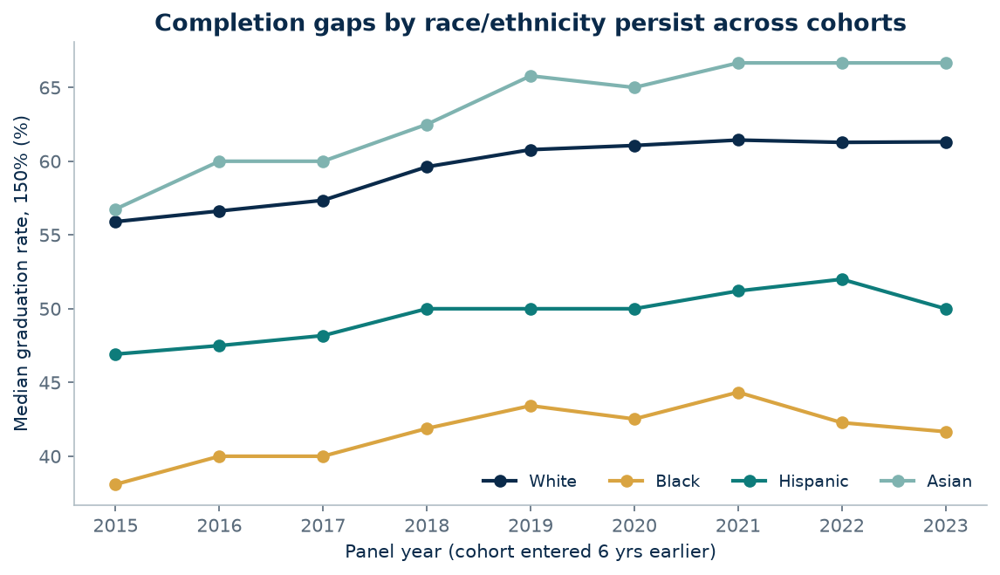

Median institutional graduation rates, 2023 panel (cohorts ≥ 100 students): **Asian 66.7%, White 61.3%,
Hispanic 50.0%, Black 41.7%**. The White–Black median gap is **19.6 pp** — wider than in 2015 (17.8 pp). The
White–Hispanic gap is **11.3 pp**.

## Peer groups: four kinds of four-year institutions

K-means clustering (k selected by silhouette over k = 3–8) on the fall-2022 cross-section — scale, selectivity,
retention, Pell share, instructional spending, student–faculty ratio, graduate share and student-body
composition. Population: the **1,753** four-year institutions with undergraduate programs that report admissions
selectivity (open-enrollment institutions are out of scope by design — see dictionary). Chosen k = 4,
silhouette **0.199** (modest — institutional data does not fall into tidy islands, and the README won't pretend
otherwise).

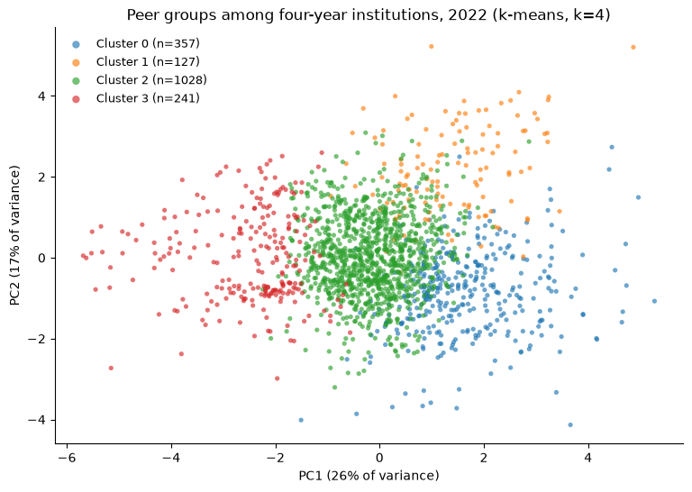

| Peer group | n | Median enrollment | Admit rate | Retention | Grad rate | Pell share | Spend / FTE |
|---|---:|---:|---:|---:|---:|---:|---:|
| **Small access colleges** | 357 | 852 | 73.3% | 64% | 39.2% | 48% | $7,841 |
| **Large access-serving institutions** | 127 | 4,057 | 84.5% | 76% | 52.2% | 55% | $8,771 |
| **The mainstream middle** | 1,028 | 2,488 | 81.8% | 76% | 57.9% | 30% | $10,791 |
| **Selective and well-resourced** | 241 | 5,165 | 38.9% | 91% | 84.3% | 17% | $22,236 |

UNC Wilmington and Trine University both land in **the mainstream middle**; Harvard sits in **selective and
well-resourced** (full profiles and representative members: `outputs/cluster_profiles.csv`; labels and
descriptions: `outputs/cluster_labels.json`).

## Predicting completion

**Model:** gradient-boosted trees (HistGradientBoosting) predicting an institution's graduation rate (150%)
from its profile — selectivity, test scores, retention, Pell share, spending, size, student-body composition,
control and Carnegie group. Institutions with bachelor's cohorts < 50 are excluded (their rates are noise).

**Discipline:** *time-based split* — train on 2015–2019 (n = 9,474), test on 2021–2023 (n = 5,389); 2020 is
excluded entirely as a pandemic-transition collection year. Robustness: GroupKFold by institution on the
training years (no institution on both sides of a fold).

| | R² | MAE | RMSE |
|---|---:|---:|---:|
| **This model (held-out 2021–2023)** | **0.745** | **7.15 pp** | 10.01 pp |
| Baseline: predict the training median | −0.015 | 16.30 pp | 19.97 pp |
| Baseline: predict the sector mean | 0.054 | 15.59 pp | 19.27 pp |
| Grouped CV on training years (mean R²) | 0.779 | — | — |

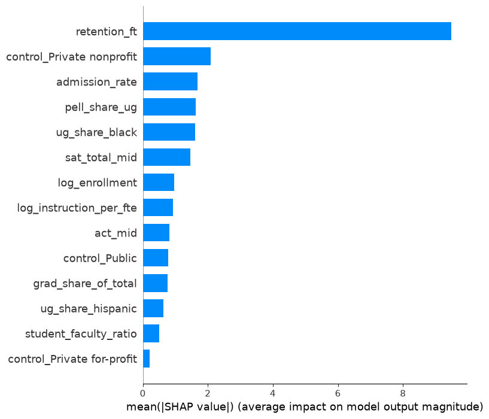
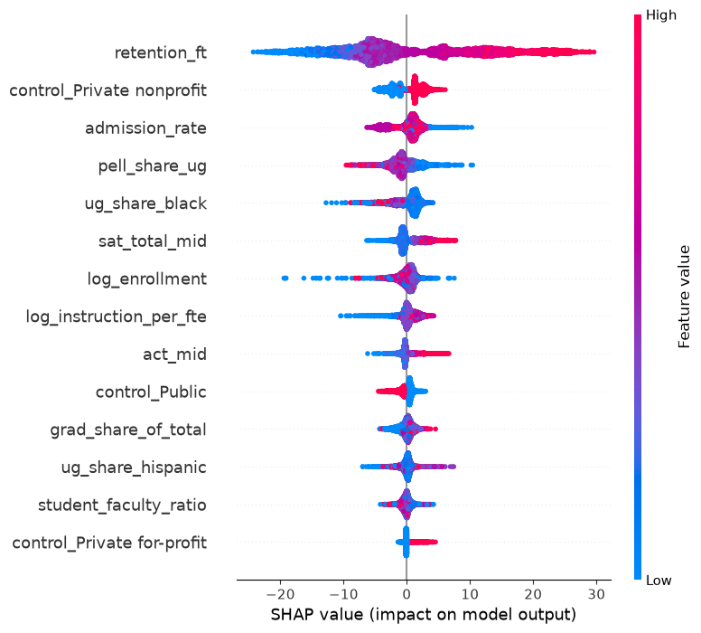

**What the model actually uses** (mean |SHAP|, percentage points): first-year retention dominates (**9.49**) —
an institution that keeps its first-years finishes them. Then private-nonprofit control (2.09), admission rate
(1.69), Pell share (1.63), Black share of undergraduates (1.61) and SAT midpoint (1.47). Two of the top six are
*student-body composition* variables: the model is reading who enrolls, which is exactly why it must not be read
causally (see Limitations).

**Where it fails — reported, not hidden:**
- **Fairness slices:** test MAE is **5.2 pp** for low-Pell institutions vs **8.5 pp** for high-Pell ones, and
  **13.9 pp** for private for-profits vs 6.7–7.0 pp elsewhere. The model is least accurate precisely where
  outcomes are most fragile.
- **Structural misses:** the largest over-predictions are university *branch campuses* (e.g., Penn State's
  regional campuses) — their features describe the flagship system, their outcomes don't. The largest
  under-predictions are mission-niche institutions (culinary, religious, tribal-serving) whose profiles look
  weak but whose completion is high. Both failure modes are about institutional structure the features can't see.

## Equity cut: the Pell completion gap

The Outcome Measures survey follows entering cohorts for eight years and reports award attainment separately
for Pell Grant recipients — the cleanest federal Pell-gap measure (this cut uses full-time, first-time cohorts,
survey years 2017–2023, cohorts entering fall 2009–2015).

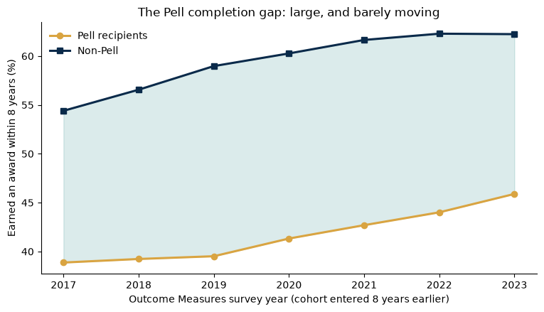

- **National (student-weighted) 8-year award rates, latest cohort (entered fall 2015): Pell 45.9% vs non-Pell
  62.2% — a 16.4 pp gap.** Across the seven cohorts the gap ranged 15.5–19.5 pp. It is not closing.
- **More time does not close it:** the gap is 14.6 pp at 4 years, 16.6 pp at 6, 16.3 pp at 8.
- **The typical institution's gap is smaller than the typical student's:** median institutional gap **7.7 pp**
  (IQR 2.5–13.1; n = 2,490 institutions with both cohorts ≥ 50) — but weighted by students, the gap is 16.4 pp.
  Only **16.0%** of institutions graduate Pell recipients at rates equal to or above their non-Pell peers.
- Median gaps by control: private nonprofit **8.9 pp**, public **7.5 pp**, private for-profit **3.1 pp** — the
  last is no equity win: for-profits post the smallest gap because *both* groups complete at low rates.
- Spotlights (fall-2015 entrants): UNC Wilmington — Pell **67.3%** vs non-Pell **74.6%** (gap 7.3 pp);
  Trine — **52.5%** vs **68.1%** (gap 15.6 pp); Harvard — **96.6%** vs **98.6%** (gap 2.0 pp).

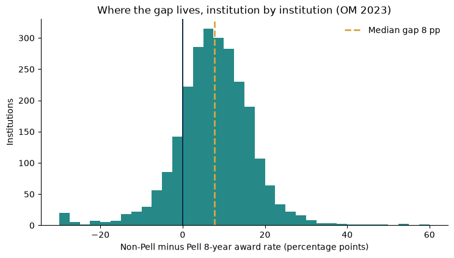
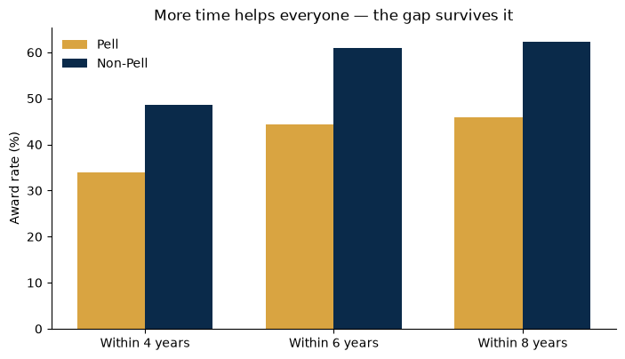

## Power BI-ready star schema

`data/star_schema/` — built the way an IR office actually models it:

| Table | Grain | Rows |
|---|---|---:|
| `dim_institution.csv` | one row per institution (latest attributes) | 8,670 |
| `dim_year.csv` | one row per panel year, with cohort annotations | 9 |
| `fact_institution_year.csv` / `.parquet` | institution × fall year (measures) | 27,005 (CSV, four-year) / 60,885 (parquet, full) |
| `fact_equity_om.csv` | institution × OM survey year (Pell outcomes) | 25,176 |

Core measures in DAX: [`dax/measures.dax`](dax/measures.dax) (median rates, cohort-weighted rates, Pell-gap
medians, share of institutions where Pell ≥ non-Pell).

## Interactive app

```bash
streamlit run app.py
```

Filter by year, state, control and Carnegie group; explore the selectivity–completion scatter, the peer groups,
the national Pell-gap trend, and any single institution's trajectory.

## Integrity checks (run, not asserted)

- **Spot-validation** against published IPEDS figures (`outputs/validation_panel_extract.csv`):

| Institution (2022) | Panel | Published |
|---|---|---|
| Harvard admission rate | 3.2% | 3.2% |
| Harvard graduation rate (150%) | 97.8% | ~98% |
| Harvard total enrollment | 30,631 | 30,631 |
| UNC Wilmington graduation rate (150%) | 74.2% | ~74–77% band |

- **Internal consistency:** GR time-band cells sum exactly to the 150% completer total; OM Pell + non-Pell
  adjusted cohorts sum to the all-student cohort.
- **Suppression log:** 209 institution-years had completers > cohort (impossible rates, median cohort size 2);
  rates set to NaN, counts kept (`outputs/coverage.json`).
- **Missingness report:** `outputs/missingness.csv` (share missing per variable per year).
- **One variable deliberately dropped:** EF-D's `PGRCOHRT` could not be reconciled with any verifiable
  definition, so it is excluded and the reason documented in the dictionary. A variable you can't define is
  worse than one fewer variable.

## Limitations — read before citing

1. **The model is a profile model, not a crystal ball.** Features are measured in the year the outcome is
   *reported*; the graduating cohort entered six years earlier. It answers "what do high-completion
   institutions look like?" — it is **not** an early-warning system and supports **no causal claims**.
   Retention's SHAP dominance partly reflects that retention and graduation measure overlapping processes.
2. **Selection is the story.** The strongest signals (SAT profile, Pell share, student-body composition)
   describe *who enrolls*. Nothing here estimates what would happen to a given student at a different
   institution.
3. **Known breaks:** the SAT was redesigned mid-panel (2016–17 values are not like-for-like); panel year 2023
   lacks aid/finance (NCES had not posted those files at build time); SAT/ACT coverage thins in the
   test-optional era; clustering covers only institutions that report admissions selectivity.
4. **Outcome Measures equity cut** uses full-time, first-time cohorts for comparability; part-time and
   transfer-in students (a large share of Pell recipients) are in the OM data but not in this cut.

## Reproduce

```bash
python -m venv .venv && source .venv/bin/activate
pip install -r requirements.txt
python src/01_download.py      # ~150 MB of NCES bulk files (not committed)
python src/02_build_panel.py   # -> data/processed/ipeds_panel.parquet + QA outputs
python src/03_eda.py           # charts + EDA stats
python src/04_clustering.py    # peer groups
python src/05_model.py         # model + SHAP + fairness slices
python src/06_equity.py        # Outcome Measures Pell-gap analysis
python src/07_star_schema.py   # Power BI star schema
streamlit run app.py
```

## Data & provenance

**Source:** National Center for Education Statistics, IPEDS Data Center bulk data files
(`https://nces.ed.gov/ipeds/datacenter/data/`), accessed **October 19–20, 2026**. 94 of 99 requested files were
available; the five not yet posted by NCES (AY2023-24 aid and finance files, OM2024) are documented in the data
dictionary. The Urban Institute Education Data Portal API was evaluated first and was returning errors on all
IPEDS endpoints at build time; the NCES originals are the source of record. IPEDS data is public domain
(U.S. Department of Education).

## Repository layout

```
ipeds-outcomes-lab/
├── app.py                  # Streamlit explorer
├── data_dictionary.md      # every variable, every break, every judgment call
├── src/                    # 01 download → 07 star schema (numbered pipeline)
├── data/
│   ├── processed/          # panel + OM equity + cluster assignments (parquet/csv)
│   └── star_schema/        # Power BI dims & facts
├── dax/measures.dax        # core Power BI measures
└── outputs/                # metrics.json, charts/, QA reports, run artifacts
```

## License

MIT — see [LICENSE](LICENSE). IPEDS data itself is public domain.
